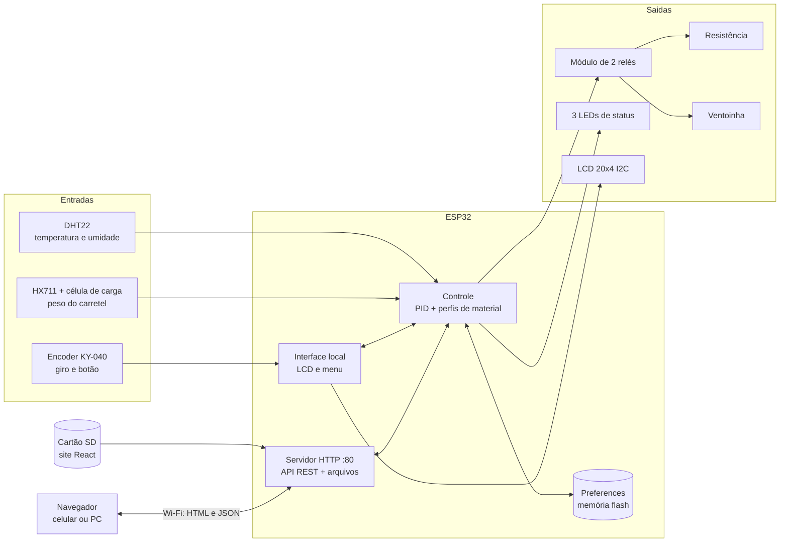
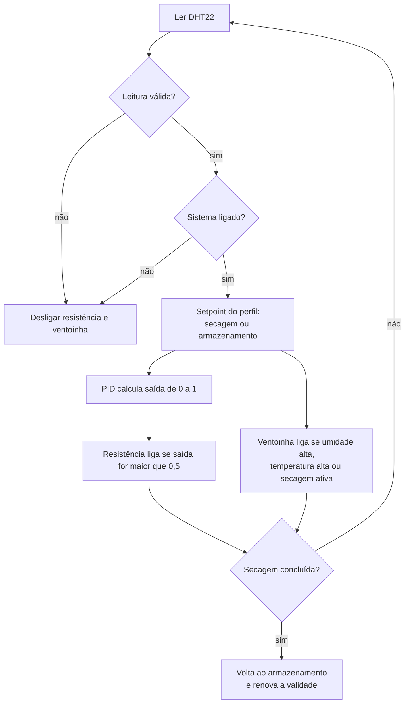

# PrintSafe — Estufa Inteligente para Filamentos 3D


O **PrintSafe** é uma estufa/caixa de armazenamento controlada por ESP32 para filamentos de impressora 3D. Ele **seca** o filamento com temperatura controlada por PID, **armazena** o carretel com temperatura e umidade monitoradas, **pesa** o carretel para saber quanto filamento resta e acompanha a **validade** do material — tudo com display LCD, encoder rotativo e um painel web acessível pelo celular ou computador.

O projeto tem três partes:

| Parte | O que é | Pasta |
|---|---|---|
| **Firmware** | Código C++ (Arduino) para ESP32-S3 N16R8 | `firmware/` |
| **Site** | Painel web em React + Vite, servido pelo próprio ESP32 a partir do cartão SD | `software/printsafe-web/` |
| **Emulador** | Servidor Python que imita os endpoints do ESP32, para desenvolver sem hardware | `software/` |

## Sumário

- [Para que serve](#para-que-serve)
- [Funcionalidades](#funcionalidades)
- [Arquitetura](#arquitetura)
- [Tecnologias e linguagens](#tecnologias-e-linguagens)
- [Estrutura do repositório](#estrutura-do-repositório)
- [Possibilidades futuras](#possibilidades-futuras)
- [Instalação do hardware](#instalação-do-hardware)
- [Instalação do software](#instalação-do-software)
- [Emulador](#emulador)
- [API HTTP](#api-http)
- [Solução de problemas](#solução-de-problemas)
- [Limitações e segurança](#limitações-e-segurança)
- [Licença e créditos](#licença-e-créditos)

---

## Para que serve

Muitos filamentos são **higroscópicos**: absorvem umidade do ar. Filamento úmido causa estalos durante a extrusão, bolhas, *stringing*, superfície áspera e peças mais frágeis. Nylon e PETG sofrem muito com isso; PLA e TPU também degradam com o tempo.

O PrintSafe resolve três problemas práticos:

1. **Secar antes de imprimir.** Cada material tem um perfil de temperatura e duração (por exemplo, PLA a 50 °C por 5 h, Nylon a 80 °C por 12 h). Você escolhe o material e inicia a secagem; o sistema mantém a temperatura com PID e circula ar com a ventoinha.
2. **Armazenar com segurança.** Fora da secagem, a estufa entra no modo de armazenamento: mantém uma temperatura branda e liga a ventoinha quando a umidade passa do alvo do material.
3. **Saber o que você tem.** A balança com célula de carga mostra quanto filamento resta no carretel (em gramas e em %), e um contador de dias indica a validade do filamento desde a última secagem.

Como o painel é web, dá para acompanhar a secagem pelo celular, ver o histórico de temperatura e umidade e iniciar ou parar o processo sem ficar na frente da máquina. Se o Wi-Fi cair, o equipamento continua funcionando localmente pelo LCD e pelo encoder.

## Funcionalidades

### Perfis de material

Os perfis ficam na constante `PERFIS` do firmware.

| Material | Temp. de secagem | Tempo de secagem | Temp. de armazenamento | Umidade alvo | Validade inicial |
|---|---|---|---|---|---|
| PLA | 50 °C | 5 h (300 min) | 28 °C | 20 % | 730 dias |
| PETG | 65 °C | 7 h (420 min) | 30 °C | 15 % | 730 dias |
| ABS | 70 °C | 8 h (480 min) | 40 °C | 10 % | 365 dias |
| Nylon | 80 °C | 12 h (720 min) | 45 °C | 10 % | 180 dias |
| TPU | 50 °C | 4 h (240 min) | 25 °C | 20 % | 365 dias |

### Controle

- **Leitura dos sensores a cada 2 s** (DHT22). A balança é lida a cada 500 ms (média de 3 leituras).
- **PID de temperatura** (biblioteca PID_v1, `Kp=2`, `Ki=5`, `Kd=1`). A saída vai de 0 a 1 e a **resistência liga quando a saída passa de 0,5**.
- **Ventoinha** liga quando qualquer uma destas condições for verdadeira:
  - a umidade passa do alvo do material em mais de 5 pontos percentuais;
  - a temperatura passa do setpoint em mais de 3 °C;
  - o modo de secagem está ativo (ventilação contínua).
- **Estado seguro:** se a leitura do DHT22 falhar (valor inválido ou fora da faixa), resistência e ventoinha são desligadas imediatamente. O mesmo acontece quando o sistema está desligado.
- **Secagem com fim automático:** ao completar o tempo do perfil, o sistema encerra a secagem, volta ao modo de armazenamento e **renova a validade** do filamento.
- **Validade:** com o sistema ligado e fora da secagem, o contador de dias diminui a cada 24 h. Trocar o material reinicia o contador com a validade inicial do novo perfil.
- **Inicialização segura:** o sistema sempre **liga desligado**. Depois de uma queda de energia, nada aquece até alguém ligar de novo.

### Interface local: LCD 20x4 e encoder

O LCD alterna automaticamente (a cada 4 s) entre três páginas e atualiza a cada 1 s:

| Página | Conteúdo |
|---|---|
| Principal | Temperatura, umidade, setpoint, material, barra do carretel com %, modo (ARMAZ/SECAG), tempo restante e ícones de resistência e ventoinha |
| Filamento | Material, peso atual e máximo, barra de %, dias de validade |
| Status | Versão, endereço IP, estado de resistência e ventoinha, setpoint e umidade |

O **encoder rotativo** com botão funciona assim:

| Ação | No modo normal | No menu |
|---|---|---|
| **Girar** | Troca o material (circular) | Navega entre os itens |
| **Pressionar** | Abre o menu | Executa o item selecionado e fecha o menu |

Itens do menu: **Ligar / Desligar**, **Secar**, **Armazenar**, **Zerar Tara**, **Cancelar**.

### Painel web

O site em React mostra tudo em tempo real (atualização a cada 2 s) e permite controlar o equipamento:

- cartões de temperatura, umidade, modo, material, estado das saídas e validade;
- barra de peso do filamento e gráficos com as últimas 60 leituras;
- ligar/desligar, alternar secagem/armazenamento, trocar o material e reiniciar a validade;
- zerar a tara, definir o peso máximo do carretel e calibrar a balança com um peso conhecido;
- aviso quando o sensor falha e indicador de conexão (online/offline);
- tema claro/escuro automático, layout responsivo para celular.

### Persistência

O firmware usa a `Preferences` do ESP32 (namespace `printsafe`) para guardar, entre reinicializações:

| Chave | Conteúdo |
|---|---|
| `material` | Índice do material selecionado |
| `dias` | Dias de validade restantes |
| `pesoMax` | Peso máximo do carretel (g) |
| `hxScale` | Fator de escala da balança |
| `hxOffset` | Offset da tara |
| `tara` | Valor da tara (zerado a cada tara) |

O estado ligado/desligado e o modo de secagem **não** são salvos de propósito.

### Rede e arquivos

- Wi-Fi em modo estação. A conexão inicial espera até 10 s; depois disso a reconexão é automática e não bloqueante (checagem a cada 5 s, nova tentativa a cada 30 s).
- Servidor HTTP na porta 80 com API REST em JSON e CORS liberado.
- O site fica no **cartão SD**, acessado via **SPI** (`/sdcard/web`). O firmware serve qualquer arquivo dessa pasta, então trocar o site não exige regravar o firmware. A pasta `/sdcard/logs` também é criada na montagem (reservada para futuros registros).

## Arquitetura



Lógica do ciclo de controle (executado a cada 2 s):



## Tecnologias e linguagens

| Camada | Tecnologia |
|---|---|
| Firmware | **C++** com o framework **Arduino-ESP32**; APIs do **ESP-IDF** para montar o cartão SD via **SPI** (`esp_vfs_fat_sdspi_mount`) e acessar os arquivos com `fopen`/`fread` |
| Comunicação | **HTTP/1.1**, **REST** com **JSON**, **CORS**; Wi-Fi 2,4 GHz |
| Site | **JavaScript (JSX)**, **React 18**, **Vite 5**, **CSS** puro (sem biblioteca de gráficos: SVG feito à mão) |
| Emulador | **Python 3.8+**, apenas biblioteca padrão (`http.server`, `threading`, `json`) |
| Automação no Windows | Arquivos **Batch** (`.bat`) |
| Ferramentas | Arduino IDE 2.x (ou `arduino-cli`), Node.js 18+ e npm |

**Bibliotecas do firmware**

| Biblioteca | Autor | Uso |
|---|---|---|
| WiFi, WebServer, Wire, Preferences | Espressif (núcleo) | Rede, servidor HTTP, I2C, memória não volátil |
| DHT sensor library + Adafruit Unified Sensor | Adafruit | Sensor DHT22 |
| HX711 | Bogdan Necula (bogde) | Amplificador da célula de carga |
| ArduinoJson (v6) | Benoit Blanchon | Serialização e leitura de JSON |
| PID (PID_v1) | Brett Beauregard | Controle PID |
| LiquidCrystal_I2C | Frank de Brabander | LCD 20x4 via I2C |

## Estrutura do repositório

Sugestão de organização (a pasta do *sketch* precisa ter o **mesmo nome do arquivo `.ino`**, exigência do Arduino):

```text
PrintSafe/
├── README.md
├── .gitignore
├── firmware/
│   └── PrintSafe/
│       └── PrintSafe.ino              # ESP32-S3 N16R8
└── software/
    ├── printsafe_emulator.py          # emulador dos endpoints
    ├── iniciar_emulador.bat           # inicia o emulador (Windows)
    ├── construir_site.bat             # instala dependências e gera o site (Windows)
    ├── printsafe-web/                 # código-fonte do site (React + Vite)
    │   ├── package.json
    │   ├── vite.config.js
    │   ├── index.html
    │   └── src/  (App.jsx, Grafico.jsx, api.js, main.jsx, styles.css)
    └── web/                           # GERADA pelo build; é o que vai para o SD
```

Conteúdo sugerido para o `.gitignore`:

```gitignore
node_modules/
software/web/
software/printsafe_prefs.json
__pycache__/
```

## Possibilidades futuras

> Esta seção é **especulativa**. Nada abaixo está implementado: são ideias que cabem nos recursos da placa ESP32-S3 N16R8 (8 MB de PSRAM, 16 MB de flash, USB nativo, BLE 5 e 45 GPIOs).

| Ideia | Como usaria o hardware do S3 N16R8 | Esforço |
|---|---|---|
| **Registro de longo prazo** | Histórico de horas ou dias em CSV na pasta `/logs` do SD (já criada pelo firmware) e gráficos de 24 h no site; a PSRAM guardaria um buffer grande antes de gravar | Baixo |
| **Cartão SD via SDMMC (1 ou 4 bits)** | Trocar o SPI pelo periférico SDMMC do ESP32-S3, que aceita pinos livres pela matriz de GPIO, para ler o site e gravar logs mais rápido; exige soquete microSD com todos os pinos (CLK, CMD, DAT0 a DAT3), alimentação direta de 3,3 V e *pull-ups* de 10 kΩ em CMD e DAT0 a DAT3. Os GPIO 9 a 14 formam um bloco livre que comporta os seis sinais | Baixo |
| **Atualização OTA pelo navegador** | Os 16 MB de flash comportam duas partições de aplicação amplas, permitindo enviar um novo firmware pelo site sem cabo | Médio |
| **Notificações** | Aviso no celular (Telegram, ntfy) ao fim da secagem, sensor falhando ou umidade alta | Baixo |
| **Integração com Home Assistant (MQTT)** | Publicar sensores e aceitar comandos com *autodiscovery* | Médio |
| **Wi-Fi sem credenciais no código** | Provisionamento por BLE 5 ou por portal cativo (modo AP) para configurar a rede pelo celular | Médio |
| **Endereço `printsafe.local`, HTTPS e senha** | mDNS, TLS e autenticação na API (os 8 MB de PSRAM dão folga para o TLS) | Médio |
| **Atualização em tempo real** | WebSocket ou Server-Sent Events no lugar do polling de 2 s; servidor assíncrono | Médio |
| **Câmera para o carretel ou a impressão** | Câmera OV2640/OV5640 pela interface DVP, com *framebuffer* na PSRAM, para *timelapse* ou conferir o nível de filamento | Alto |
| **Display gráfico** | Tela TFT/LVGL no lugar do LCD 20x4, com *framebuffer* na PSRAM | Alto |
| **Identificação do carretel por RFID/NFC** | Leitor MFRC522 ou PN532 para escolher o perfil automaticamente e guardar o histórico de cada carretel | Médio |
| **Perfis personalizados** | Criar e editar materiais (PA-CF, ASA, PC, etc.) pelo site, salvos em JSON no SD | Baixo |
| **Agendamento** | Iniciar a secagem em um horário (NTP) para o filamento estar pronto quando você acordar | Baixo |
| **Auto-ajuste do PID** | Rotina de *autotune* e modelo térmico que se adapta ao tamanho da estufa | Médio |
| **Previsão do fim da secagem** | Estimar o tempo restante a partir da curva de umidade (inclusive com TensorFlow Lite Micro, aproveitando as instruções vetoriais do S3) | Alto |
| **Mais sensores de segurança** | Sensor de temperatura independente junto à resistência (DS18B20) com corte por sobretemperatura, sensor de corrente para detectar resistência queimada, tacômetro da ventoinha e chave de porta | Médio |
| **Separar controle e rede em núcleos** | Tarefa FreeRTOS de controle em um núcleo e rede/web no outro, para um controle sempre previsível | Médio |
| **USB como armazenamento** | Expor o cartão SD ao computador como pendrive (USB MSC nativo) para trocar o site arrastando arquivos (exige liberar os GPIO 19 e 20, hoje usados pelos relés) | Médio |

## Instalação do hardware

### Lista de materiais

| Item | Quantidade | Observações |
|---|---|---|
| ESP32-S3-DevKitC-1 N16R8 (ou compatível) | 1 | 16 MB de flash e 8 MB de PSRAM octal |
| Sensor DHT22 (AM2302) | 1 | Se for só o sensor de 4 pinos, use um resistor de 10 kΩ entre DATA e 3,3 V |
| Módulo HX711 + célula de carga | 1 | Célula tipo barra de 1 kg ou 5 kg; o peso máximo configurável vai de 1 a 5000 g |
| Display LCD 20x4 com adaptador I2C (PCF8574) | 1 | Endereço padrão 0x27 (alguns usam 0x3F) |
| Módulo para cartão microSD (SPI) | 1 | Cartão formatado em FAT32 |
| Encoder rotativo com botão (KY-040) | 1 | |
| Módulo de relé de 2 canais, 5 V, com optoacoplador | 1 | Acionamento em nível baixo (o firmware já considera isso) |
| LEDs de 5 mm + resistores de 330 Ω | 3 + 3 | Wi-Fi, resistência e ventoinha |
| Resistência de aquecimento | 1 | Dimensionada para a sua estufa e para a tensão disponível |
| Ventoinha | 1 | Para circular o ar |
| Fusível térmico (ou termostato) | 1 | **Proteção independente do firmware**, em série com a resistência |
| Fonte de 5 V (2 A ou mais) | 1 | Para a eletrônica |
| Fios, placa de montagem ou PCB, caixa isolante | — | A estufa e a eletrônica devem ficar separadas |

### Esquema de ligação

Todas as ligações usam **3,3 V de lógica**. Ligue **todos os GND juntos** ao GND do ESP32-S3.

| Componente | Pino do módulo | GPIO | Alimentação |
|---|---|---|---|
| DHT22 | DATA | 17 | VCC 3,3 V · GND |
| HX711 | DOUT | 4 | VCC 3,3 V · GND |
| HX711 | SCK | 8 | |
| LCD I2C | SDA | 15 | VCC 5 V · GND |
| LCD I2C | SCL | 16 | |
| Módulo SD | CS | 10 | VCC 5 V · GND (módulo com regulador) |
| Módulo SD | MOSI | 11 | |
| Módulo SD | SCK | 12 | |
| Módulo SD | MISO | 13 | |
| Encoder | CLK | 7 | + 3,3 V · GND |
| Encoder | DT | 6 | |
| Encoder | SW | 5 | |
| Módulo de relés | IN1 (resistência) | 19 | VCC 5 V · GND |
| Módulo de relés | IN2 (ventoinha) | 20 | |
| LED Wi-Fi | ânodo (via 330 Ω) | 38 | cátodo no GND |
| LED da resistência | ânodo (via 330 Ω) | 39 | cátodo no GND |
| LED da ventoinha | ânodo (via 330 Ω) | 40 | cátodo no GND |

#### Pinos do N16R8 evitados

O mapa de pinos foi escolhido para **não conflitar** com os recursos internos do módulo ESP32-S3 N16R8, de modo que a PSRAM pode ficar habilitada sem problemas:

| Pinos | Motivo | Situação neste projeto |
|---|---|---|
| GPIO 26 a 32 | Flash e PSRAM | Não usados |
| GPIO 33 a 37 | PSRAM octal (8 MB) | Não usados (os LEDs de resistência e ventoinha ficam nos GPIO 39 e 40) |
| GPIO 0, 3, 45 e 46 | *Strapping* (modo de boot) | Não usados |
| GPIO 19 e 20 | USB nativo (D− e D+) | **Usados pelos relés** (veja a observação abaixo) |

> [!NOTE]
> Como os relés usam os GPIO 19 e 20, o **USB nativo fica indisponível** com o firmware em execução. Grave e depure pela **porta UART (COM)** da placa. Se um dia você quiser usar o USB nativo, mova os relés para outros pinos livres (por exemplo, GPIO 1 e 2).

#### Detalhes de cada módulo

**DHT22.** Instale o sensor dentro da câmara, longe do fluxo direto da resistência e perto da entrada de ar. Se o seu módulo tiver só 3 pinos, o resistor de *pull-up* já vem na placa.

**HX711 e célula de carga.** Ligue os fios da célula aos terminais **E+**, **E−**, **A+** e **A−** do HX711 (as cores variam por fabricante; o mais comum é vermelho em E+, preto em E−, branco em A− e verde em A+; se o peso sair invertido, troque A+ e A−). Alimente o HX711 com 3,3 V. Monte a célula de modo que o carretel fique apoiado sobre uma plataforma presa em uma só extremidade da barra.

**LCD 20x4 I2C.** Alimente com 5 V. Se o display acender mas não mostrar texto, ajuste o potenciômetro de contraste na parte de trás. Se nem acender, o endereço pode ser 0x3F: altere `LCD_ADDR` no firmware.

> [!TIP]
> O adaptador PCF8574 costuma ter *pull-ups* ligados ao VCC. Com o LCD em 5 V, as linhas SDA e SCL podem chegar a 5 V nos pinos do ESP32, que são de 3,3 V. Muita gente usa assim sem problemas, mas o ideal é remover os resistores de *pull-up* do adaptador (e usar os do ESP32) ou usar um conversor de nível.

**Módulo SD (SPI).** Use um módulo SPI para microSD com regulador e conversor de nível (os mais comuns) alimentado com 5 V, ou um adaptador de 3,3 V. Formate o cartão em **FAT32** (cartões de até 32 GB são os mais seguros). Os sinais usam os GPIOs 10 a 13, que são os pinos nativos do barramento FSPI do ESP32-S3; se precisar, altere as constantes `SD_*_PIN` do firmware. A frequência do barramento é de 20 MHz: se o cartão falhar ao montar, reduza `host.max_freq_khz` no firmware ou confira os fios. Se você usar um soquete microSD sem módulo, adicione *pull-ups* de cerca de 10 kΩ em MISO e CS.

**Encoder KY-040.** Os três sinais usam *pull-up* interno do ESP32. O giro é lido por interrupção no pino CLK e o botão tem filtro de 50 ms.

**Módulo de relés.** Alimente com 5 V. O firmware aciona os relés em **nível baixo** (`RELE1_INV` e `RELE2_INV` como `true`); se o seu módulo for ativo em nível alto, mude essas constantes para `false`. Se o relé fechar por um instante ao ligar o ESP32, coloque um resistor de 10 kΩ entre cada entrada IN e 3,3 V.

**LEDs.** Cada LED vai em série com um resistor de 330 Ω, ânodo no GPIO e cátodo no GND.

### Ligação da carga (resistência e ventoinha)

O relé funciona como uma chave: o circuito de potência passa pelos contatos **COM** e **NO** de cada canal, completamente separado da eletrônica de 3,3 V e 5 V.

```text
Alimentação da carga ──► [fusível térmico] ──► COM ┐
                                                   │ relé 1 (NO) ──► resistência ──► retorno
                                                   ┘
Alimentação da ventoinha ──────────────────► COM ┐
                                                  │ relé 2 (NO) ──► ventoinha ──► retorno
                                                  ┘
```

> [!CAUTION]
> **Segurança.** Se a resistência funcionar em tensão de rede (110/220 V), trabalhe com a tomada desligada, use fio com bitola adequada, isole todos os contatos, mantenha a parte de alta tensão fisicamente separada da eletrônica e, se não tiver experiência, peça ajuda a quem tenha. Respeite a corrente máxima dos contatos do relé. **Sempre instale um fusível térmico ou termostato de proteção em série com a resistência:** o firmware desliga a resistência em caso de falha do sensor, mas ele não protege contra um relé travado fechado. Não deixe a estufa funcionando sem supervisão até testar bem o sistema.

### Teste inicial (antes de ligar a carga)

1. Monte e confira toda a ligação **sem** a resistência e a ventoinha conectadas.
2. Grave o firmware (veja a próxima seção).
3. Ao ligar, os três LEDs acendem em sequência (teste visual) e o LCD mostra a tela de abertura.
4. Veja no monitor serial se o DHT22, o HX711 e o SD aparecem como OK.
5. Gire o encoder e confira se o material muda; pressione e confira o menu.
6. Ligue o sistema pelo menu e escute os relés estalando: só então conecte a carga.

## Instalação do software

### 1. Preparar o ambiente de gravação

1. Instale a **Arduino IDE 2.x**.
2. Em *Arquivo → Preferências*, adicione em "URLs adicionais para gerenciadores de placas":
   ```
   https://espressif.github.io/arduino-esp32/package_esp32_index.json
   ```
3. Em *Ferramentas → Placa → Gerenciador de placas*, instale **esp32 by Espressif Systems** (série 2.x ou 3.x).
4. Em *Ferramentas → Gerenciar bibliotecas*, instale:
   - `DHT sensor library` (Adafruit) e, se pedir, `Adafruit Unified Sensor`
   - `HX711` (Bogdan Necula)
   - `ArduinoJson` (Benoit Blanchon), versão 6.x
   - `PID` (Brett Beauregard)
   - `LiquidCrystal I2C` (Frank de Brabander)
5. Se a placa não for reconhecida no computador, instale o driver do conversor USB-serial (CP210x ou CH340).

### 2. Configurar o firmware

Abra o sketch `PrintSafe.ino` e edite:

```cpp
const char* WIFI_SSID     = "SEU_WIFI";
const char* WIFI_PASSWORD = "SUA_SENHA";
```

Outros ajustes úteis, no começo do arquivo: `LCD_ADDR` (0x27 ou 0x3F), `RELE1_INV`/`RELE2_INV` (lógica do relé), os pinos e os perfis em `PERFIS`.

### 3. Gravar na placa

Em *Ferramentas*, configure:

| Opção | Valor |
|---|---|
| Placa | ESP32S3 Dev Module |
| Flash Size | 16MB |
| PSRAM | OPI PSRAM (opcional: o firmware não a usa, e o mapa de pinos já evita os pinos dela) |
| USB CDC On Boot | Disabled (os relés ocupam os pinos do USB nativo; grave e depure pela porta UART) |
| Porta | a porta COM da placa |

Clique em **Carregar**. Se aparecer "Connecting........", segure o botão **BOOT** da placa até a gravação começar.

**Alternativa com `arduino-cli`:**

```bash
arduino-cli core install esp32:esp32
arduino-cli lib install "DHT sensor library" "Adafruit Unified Sensor" "HX711 Arduino Library" "ArduinoJson@6.21.5" "PID" "LiquidCrystal I2C"

# ESP32-S3 N16R8 (confira as opções com: arduino-cli board details --fqbn esp32:esp32:esp32s3)
arduino-cli compile --fqbn esp32:esp32:esp32s3:FlashSize=16M,PSRAM=opi firmware/PrintSafe
arduino-cli upload  --fqbn esp32:esp32:esp32s3:FlashSize=16M,PSRAM=opi -p COM3 firmware/PrintSafe
```

### 4. Conferir pelo monitor serial

Abra o monitor serial em **115200** baud. Na inicialização você deve ver algo como:

```text
[LCD] OK
[ENC] OK
[PREFS] mat=PLA dias=730 pesoMax=1000 scale=420.000
[DHT22] OK — GPIO 17
[HX711] OK — scale=420.000 offset=0
[SD-SPI] OK — 14.84 GB
[WiFi] http://192.168.0.50
[HTTP] Pronto.
```

O endereço IP também aparece no LCD (página de status). Se o SD falhar, o equipamento continua funcionando, apenas sem o painel web (a API segue ativa).

### 5. Gerar o site

Requisitos: **Node.js 18 ou superior** ([nodejs.org](https://nodejs.org/)).

**No Windows**, dê duplo clique em `software/construir_site.bat`. Ele instala as dependências e gera o site.

**Manualmente:**

```bash
cd software/printsafe-web
npm install
npm run build
```

O build gera a pasta `software/web` com três arquivos: `index.html`, `script.js` e `style.css` (nomes fixos, de propósito, para casar com as rotas do firmware).

> [!NOTE]
> O build **esvazia** a pasta `software/web` a cada execução.

### 6. Colocar o site no cartão SD

1. Com o cartão em FAT32, crie a pasta `web` na raiz.
2. Copie para ela o **conteúdo** de `software/web` (`index.html`, `script.js` e `style.css`).
3. Insira o cartão no módulo e reinicie o ESP32. A pasta `logs` é criada automaticamente.
4. Abra `http://<IP-DO-ESP32>/` no navegador, com o celular ou computador na mesma rede Wi-Fi.

Para atualizar o site depois, basta repetir os passos 5 e 6 — não é preciso regravar o firmware.

### 7. Primeiro uso e calibração da balança

1. **Escolha o material** girando o encoder (ou pelo painel).
2. **Calibre a balança:**
   1. Com a plataforma **vazia**, toque em **Zerar tara**.
   2. Coloque um peso conhecido (por exemplo 200 g).
   3. Informe o valor em **Peso de referência (g)** e toque em **Calibrar**.
3. Defina o **peso máximo** do carretel cheio (por exemplo 1000 g), usado para calcular a porcentagem.
4. Ligue o sistema (menu do encoder ou botão do painel) e escolha **Secar** ou **Armazenar**.

Os valores de calibração ficam salvos na memória do ESP32.

> [!IMPORTANT]
> A secagem e o aquecimento só acontecem com o **sistema ligado**. Selecionar "Secagem" com o sistema desligado apenas muda o modo.

## Emulador

O emulador permite **desenvolver e testar o site sem o ESP32**. Ele reproduz as rotas, os códigos HTTP e os JSONs do firmware, com um modelo simplificado da estufa por trás.

### Como rodar

Requisito: **Python 3.8 ou superior** (só biblioteca padrão, sem instalar pacotes).

**No Windows:** dê duplo clique em `software/iniciar_emulador.bat`. Ele localiza o Python e inicia o servidor.

**Em qualquer sistema:**

```bash
cd software
python printsafe_emulator.py --porta 8080
```

Abra `http://localhost:8080/`. Se a pasta `software/web` estiver vazia, o emulador avisa; gere o site antes (passo 5 da instalação). A rota `/api/data` funciona de qualquer forma.

### Opções

| Opção | Descrição |
|---|---|
| `--porta N` | Porta HTTP (padrão 8080; o ESP32 real usa a 80) |
| `--host ENDEREÇO` | Endereço de escuta (padrão `127.0.0.1`; use `0.0.0.0` para acessar de outro dispositivo da rede) |
| `--velocidade X` | Acelera o tempo simulado (`60` = 1 minuto simulado por segundo real) |
| `--ligado` | Inicia com o sistema já ligado |
| `--novo` | Ignora as preferências salvas e começa do zero |
| `--sem-sd` | Simula cartão SD ausente (arquivos respondem 503) |
| `--latencia MS` | Atraso artificial em cada requisição |
| `--web PASTA` | Pasta dos arquivos do site (padrão `web`) |
| `--prefs ARQUIVO` | Arquivo que emula a memória `Preferences` (padrão `printsafe_prefs.json`) |
| `-v` | Mostra também `/api/data` e o corpo dos POSTs no log |

Exemplo para ver uma secagem inteira rapidamente:

```bash
python printsafe_emulator.py --ligado --velocidade 300
```

### Comandos do console

Enquanto o servidor roda, digite no prompt `emu>`:

| Comando | Efeito |
|---|---|
| `status` | Mostra o estado atual completo |
| `temp 60` | Força a temperatura real da câmara |
| `umid 40` | Força a umidade real da câmara |
| `amb 30` / `ambumid 70` | Temperatura e umidade do ambiente |
| `massa 650` | Define a massa do carretel sobre a balança |
| `dht on` / `dht off` | Simula falha do DHT22 (testa o estado seguro) |
| `balanca on` / `balanca off` | Simula a balança indisponível |
| `sd on` / `sd off` | Simula o cartão SD ausente |
| `velocidade 120` | Muda a aceleração do tempo |
| `girar +` / `girar -` | Gira o encoder (material ou menu) |
| `botao` | Pressiona o encoder |
| `ajuda` / `sair` | Lista de comandos / encerra |

### O que é simulado

- **Fiel ao firmware:** rotas e respostas, PID_v1 (porta do algoritmo), lógica de relés e ventoinha, histórico de 60 pontos, contagem de secagem e validade, menu do encoder, persistência em arquivo e erros (JSON inválido, peso fora da faixa, balança indisponível).
- **Aproximado:** a física da câmara (aquecimento, perda de calor, umidade) e o ruído dos sensores são um modelo simplificado. Serve para ver o comportamento geral, não para ajustar o PID da sua estufa real.
- **Não simulado:** LCD, LEDs, Wi-Fi, limites de memória e o fato de o servidor real atender uma requisição por vez.

### Desenvolvendo o site com recarga automática

Com o emulador rodando na porta 8080:

```bash
cd software/printsafe-web
npm run dev
```

Abra `http://localhost:5173`. As chamadas `/api/*` são encaminhadas ao emulador. Para desenvolver contra o ESP32 real:

```bash
# Linux/macOS
PRINTSAFE_URL=http://192.168.0.50 npm run dev
# Windows (cmd)
set PRINTSAFE_URL=http://192.168.0.50 && npm run dev
```

## API HTTP

Todas as rotas `/api/*` respondem com CORS liberado (`Access-Control-Allow-Origin: *`). Qualquer outra rota `/api/*` devolve `404 {"error":"Rota nao encontrada"}`; rotas fora de `/api/` são tratadas como arquivos do SD.

| Método e rota | Corpo da requisição | Resposta |
|---|---|---|
| `GET /` , `/index.html`, `/style.css`, `/script.js` | — | Arquivo do SD (`503` se o SD estiver indisponível, `404` se o arquivo não existir) |
| `GET /api/data` | — | Estado completo (veja abaixo) |
| `POST /api/comando` | `{"cmd":"TOGGLE"}` | `{"success":true}` |
| `POST /api/pesomax` | `{"pesoMaximo":1000}` | `{"success":true,"pesoMaximo":1000.0}` ou `400` fora da faixa de 1 a 5000 |
| `POST /api/tara` | — | `{"success":true,"tara":0}` ou `503` se a balança estiver indisponível |
| `POST /api/calibrar` | `{"pesoReferencia":200}` ou `{"hxScale":420}` | `{"success":true,"hxScale":419.925}` |

**Comandos de `/api/comando`:**

| `cmd` | Efeito |
|---|---|
| `TOGGLE` | Liga ou desliga o sistema |
| `MATERIAL` (com `"valor": 0..4`) | Seleciona o material (0 PLA, 1 PETG, 2 ABS, 3 Nylon, 4 TPU) e reinicia a validade |
| `SECAGEM` | Entra no modo de secagem e inicia a contagem de tempo |
| `ARMAZENAMENTO` | Volta ao modo de armazenamento |
| `RESET` | Reinicia a validade para o valor inicial do material |

Corpo ausente ou JSON inválido retornam `400`.

**Exemplo de `GET /api/data`** (o histórico foi abreviado):

```json
{
  "sensoresOK": true,
  "temp": 49.8,
  "umid": 14.2,
  "setpoint": 50.0,
  "material": "PLA",
  "materialIdx": 0,
  "modo": "Secagem",
  "ativo": true,
  "validade": 730,
  "resistencia": true,
  "ventoinha": true,
  "tempoRestante": 212,
  "historico": { "temp": [49.5, 49.6, "..."], "umid": [14.6, 14.5, "..."] },
  "pesoAtual": 842.3,
  "pesoMaximo": 1000.0,
  "pesoPercentual": 84.2,
  "tara": 0.0,
  "hxScale": 420.0
}
```

O campo `tempoRestante` (minutos) só existe durante a secagem. O histórico traz as últimas 60 leituras (uma a cada 2 s), da mais antiga para a mais recente; no início elas valem zero até o buffer encher.

**Testando com `curl`:**

```bash
curl http://localhost:8080/api/data
curl -X POST http://localhost:8080/api/comando -d '{"cmd":"SECAGEM"}'
```

No `cmd` do Windows, escape as aspas: `curl -X POST http://localhost:8080/api/comando -d "{\"cmd\":\"SECAGEM\"}"`.

## Solução de problemas

| Sintoma | Causa provável e solução |
|---|---|
| LCD acende mas sem texto | Ajuste o potenciômetro de contraste do adaptador I2C |
| LCD não acende | Troque `LCD_ADDR` para `0x3F`; confira SDA/SCL e a alimentação de 5 V |
| `SD: Falha` no LCD ou no serial | Cartão não está em FAT32, fiação do SPI incorreta, ou frequência alta demais: reduza `host.max_freq_khz` para 10000 ou 4000 |
| Site não abre (`404` ou `503`) | Falta a pasta `web` com os três arquivos no SD, ou o SD não montou. A API (`/api/data`) continua funcionando |
| Sem Wi-Fi | Confira SSID e senha (a rede deve ser de 2,4 GHz). O equipamento segue em modo local e tenta reconectar a cada 30 s |
| Peso negativo ou sempre zero | Refaça a tara com a plataforma vazia e calibre com um peso conhecido; se o valor sair invertido, troque A+ e A− |
| Peso oscila muito | Reforce a fixação da célula de carga, afaste de vibração e cabos de potência |
| `sensoresOK: false` / "estado seguro" | Leitura do DHT22 inválida: confira o fio DATA, o *pull-up* de 10 kΩ e a alimentação |
| Relés ligam invertidos | Troque `RELE1_INV` e `RELE2_INV` entre `true` e `false` |
| Relé estala ao ligar a placa | Adicione *pull-up* de 10 kΩ de cada entrada IN para 3,3 V |
| Erro "Connecting........" na gravação | Segure o botão BOOT durante a gravação; teste outro cabo USB e outra velocidade de upload |
| Não consigo gravar ou ver o serial pela porta USB nativa | Os relés usam os GPIO 19 e 20, que são os pinos do USB nativo: use a porta UART (COM) da placa para gravar e depurar |
| Emulador: "Não foi possível abrir a porta" | Porta ocupada: use `--porta 8081` |
| `.bat` não acha o Python | Instale o Python 3 e marque "Add python.exe to PATH" |

## Limitações e segurança

- **Sem proteção térmica em hardware:** o firmware desliga a resistência se o sensor falhar, mas não protege contra um relé travado. Use sempre um fusível térmico ou termostato independente.
- **Limite do DHT22:** o sensor opera até cerca de **80 °C**, exatamente o setpoint de secagem do Nylon. Para trabalhar nessa faixa com folga, considere trocar por um sensor de faixa maior (por exemplo SHT31 ou DS18B20 para a temperatura).
- **API sem autenticação:** qualquer dispositivo da mesma rede pode ligar e desligar o equipamento. Use uma rede confiável e não exponha a porta 80 à internet.
- **Credenciais no código:** SSID e senha ficam gravados no firmware.
- **Validade em dias:** a contagem usa o relógio interno (`millis`). Os dias restantes são salvos, mas a fração do dia em andamento reinicia se o ESP32 for reiniciado.
- **Servidor síncrono:** a biblioteca `WebServer` atende uma conexão por vez; evite abrir muitas abas no painel ao mesmo tempo.
- **Relé mecânico:** o PID comanda a resistência em liga/desliga. Os contatos sofrem desgaste; um relé de estado sólido (SSR) é uma boa melhoria.
- **USB nativo indisponível:** os relés ocupam os GPIO 19 e 20 (D− e D+ do USB nativo); grave e depure pela porta UART da placa.
- **Aquecimento:** a estufa deve ser feita com materiais que suportem a temperatura máxima do perfil escolhido.

##  Licença

Este projeto está sob a licença MIT. Veja o arquivo [LICENSE](LICENSE) para mais detalhes.

```
MIT License

Copyright (c) 2026 Equipe PrintSafe

Permission is hereby granted, free of charge, to any person obtaining a copy
of this software and associated documentation files (the "Software"), to deal
in the Software without restriction, including without limitation the rights
to use, copy, modify, merge, publish, distribute, sublicense, and/or sell
copies of the Software, and to permit persons to whom the Software is
furnished to do so, subject to the following conditions:

[...]
```

## 🙏 Agradecimentos

- ESP32 Community
- Arduino Team
- Todos os contribuidores open-source
- [Bruno Henrique dos Santos Silva](https://github.com/brunohss) (membro honorário)


---

<div align="center">

**Desenvolvido com ❤️ pela Equipe UNIVESP**


[⬆ Voltar ao topo](#-printsafe)

</div>
